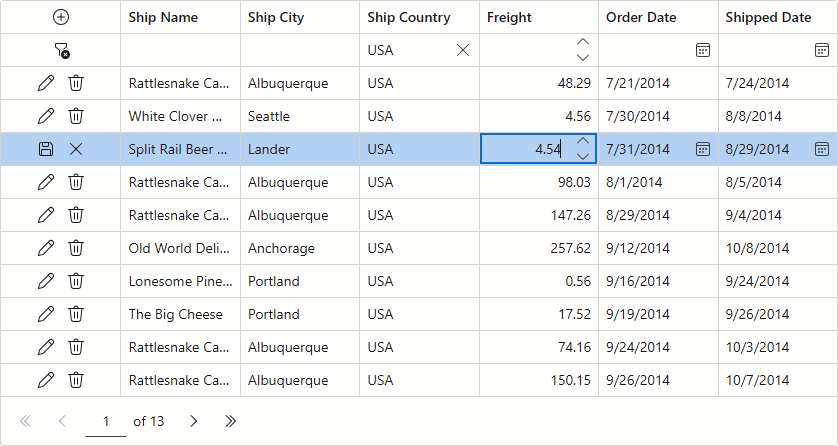

<!-- default badges list -->

[](https://supportcenter.devexpress.com/ticket/details/T1333453)
[](https://docs.devexpress.com/GeneralInformation/403183)
[](#does-this-example-address-your-development-requirementsobjectives)
<!-- default badges end -->
# Blazor Grid - Bind to OData Instant Feedback Data Source

This example binds the [DevExpress Blazor Grid UI component](https://docs.devexpress.com/Blazor/403143/components/grid) to an [OData Instant Feedback data source](https://docs.devexpress.com/Blazor/405842/components/grid/bind-to-data/server-mode#data-source-types). The data source retrieves records on demand in background threads to maintain app responsiveness. It reduces memory consumption and improves overall performance when working with large collections.



**Note**: Instant Feedback data sources impose limitations on available Grid features. Refer to the following topic for additional information in this regard: [Bind Blazor Grid to Server Mode Data Sources](https://docs.devexpress.com/Blazor/405842/components/grid/bind-to-data/server-mode#limitations).

## Quick Start

1. Run the **ODataServer** application.
2. Run the **InstantFeedback** application.

**InstantFeedback** connects to **ODataServer** at `https://localhost:5006/odata`. If  port `5006` is already in use, update URLs in [Program.cs](./CS/ODataServer/ODataServer/Program.cs#L9) and [OrdersContext.cs](./CS/InstantFeedback/InstantFeedback/Models/OrdersContext.cs#L5).

## Implementation Details

In this example, the DevExpress Blazor Grid retrieves data from an [OData](https://learn.microsoft.com/en-us/odata/) service. To bind our Blazor Grid component to this type of service, you must:

1. Add the following NuGet package to your project: [Microsoft.OData.Client](https://www.nuget.org/packages/Microsoft.OData.Client/)

2. Create data model and service context classes.
3. Add required namespaces to the page that hosts the Grid: 

    ```razor
    @using InstantFeedback.Models
    @using DevExpress.Data.ODataLinq
    ```
4. Create an [ODataInstantFeedbackSource](https://docs.devexpress.com/CoreLibraries/DevExpress.Data.ODataLinq.ODataInstantFeedbackSource) instance, configure connection parameters, and assign the instance to the Grid's [Data](https://docs.devexpress.com/Blazor/DevExpress.Blazor.DxGrid.Data) property:

    ```razor
    <DxGrid Data="ODataSource">
        <!-- ... -->
    </DxGrid>

    @code {
        ODataInstantFeedbackSource ODataSource { get; set; }

        protected override void OnInitialized() {
            ODataSource = new ODataInstantFeedbackSource();
            ODataSource.KeyExpression = "OrderId";
            ODataSource.GetSource += (sender, e) => e.Query = new OrdersContext().Orders;
        }
    }
    ```
5. Implement the [IDisposable](https://learn.microsoft.com/en-us/dotnet/api/system.idisposable) interface and dispose of the data source in the page's [Dispose](https://learn.microsoft.com/en-us/dotnet/api/system.idisposable.dispose) method:

    ```razor
    @implements IDisposable
    // ...
    @code {
        //...
        public void Dispose() {
            ODataSource?.Dispose();
        }
    }
    ```

## Files to Review

**InstantFeedback**: 
- [Index.razor](./CS/InstantFeedback/InstantFeedback/Components/Pages/Index.razor)
- [Order.cs](./CS/InstantFeedback/InstantFeedback/Models/Order.cs)
- [OrdersContext.cs](./CS/InstantFeedback/InstantFeedback/Models/OrdersContext.cs)

**ODataServer**:
- [OrdersController.cs](./CS/ODataServer/ODataServer/Controllers/OrdersController.cs)
- [Order.cs](./CS/ODataServer/ODataServer/Models/Order.cs)
- [NorthwindContext.cs](./CS/ODataServer/ODataServer/Models/NorthwindContext.cs)
- [Program.cs](./CS/ODataServer/ODataServer/Program.cs)

## Documentation

- [Bind Blazor Grid to Data](https://docs.devexpress.com/Blazor/403737/components/grid/bind-to-data)
- [Bind Blazor Grid to Server Mode Data Sources](https://docs.devexpress.com/Blazor/405842/components/grid/bind-to-data/server-mode)

## More Examples

- [Server Mode Data Processing](https://github.com/DevExpress-Examples/blazor-grid-server-mode-data)
- [Bind to an Instant Feedback Data Source Using Entity Framework Core](https://github.com/DevExpress-Examples/blazor-grid-bind-to-instant-feedback-data-source)
<!-- feedback -->
## Does This Example Address Your Development Requirements/Objectives?

[](https://www.devexpress.com/support/examples/survey.xml?utm_source=github&utm_campaign=blazor-grid-bind-to-odata-instant-feedback-source&~~~was_helpful=yes) [](https://www.devexpress.com/support/examples/survey.xml?utm_source=github&utm_campaign=blazor-grid-bind-to-odata-instant-feedback-source&~~~was_helpful=no)

(you will be redirected to DevExpress.com to submit your response)
<!-- feedback end -->
